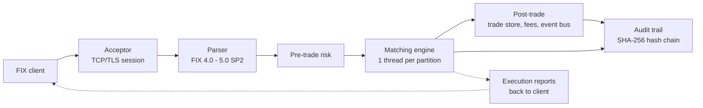

# Matching Engine

A C++20 multi-asset matching engine with deterministic, single-threaded-per-partition matching, integer-encoded prices (no floating-point math on prices or notional), and zero heap allocation on the matching hot path. It speaks FIX 4.0 through 5.0 SP2 at both the session and application layer, and every order and trade event is written to a SHA-256 hash-chained audit trail. Target jurisdiction is ADGM / FSRA; the project is in pilot-hardening, not in production use.

## Status

- **What works**: single-threaded-per-partition matching (price-time FIFO and pro-rata), the order types and time-in-force values listed below, auctions, pre-trade risk (position, credit, price bands, rate limiter, kill switch), FIX gateway with custom parser and optional QuickFIX session layer, REST and WebSocket APIs, four surveillance rules, SHA-256 audit chain, drop copy, snapshot persistence, journaling, and a React exchange portal. Unit and integration tests exist for each module (about 100 test files; run `ctest` to see current results).
- **What's prototype**: the SBE binary codec (`gateway/sbe`) is a prototype. It has its own unit tests but is not wired into the daemon, and its schema is a draft (`docs/technical/01-sbe-protocol-schema-draft.md`). FIX Market Data is a minimal path: a `MarketDataRequest` (V) is answered with a one-shot `MarketDataSnapshotFullRefresh` (W) built from current book levels. There is no incremental refresh (X) or subscription lifecycle over FIX. DR replication and automated failover, the ART order book, and the Disruptor pipeline mode are implemented but have not been validated under production conditions.
- **Not implemented**: clearing and settlement (the engine publishes trade events and exposes sync APIs for an external system), published latency numbers on reference hardware, third-party security review, regulatory certification.

## Architecture

17 C++ modules, built from the top-level `CMakeLists.txt`:

- `engine/core`: matching kernel, order books, auctions, pegged/iceberg/stop logic
- `gateway/fix`: FIX parser, gateway adapter, TCP acceptor, optional QuickFIX integration
- `gateway/sbe`: SBE binary codec (prototype, not wired in)
- `risk`: pre-trade risk (position, credit, rate limiter)
- `surveillance`: rule engine, alert pipeline, four detection rules
- `post-trade`: trade store, fee calculator, trade event bus
- `market-data`: TCP/UDP multicast publishers, L2 depth, statistics
- `dropcopy`: per-participant drop copy
- `refdata`: instrument reference data and HTTP handler
- `ops`: auth, RBAC, metrics, audit trail, REST, WebSocket
- `eod`: end-of-day processing and reconciliation
- `common`: transport abstraction (TCP/TLS), config loader
- `replication`: journal replication, health checks, failover
- `certification`: client certification harness and report writer
- `simulator`: C++ participant simulator
- `benchmark`: latency benchmark (5 scenarios, HDR-style histogram)
- `daemon`: standalone process wiring everything together, plus integration tests

Outside the C++ tree: `portal/` (React exchange ops portal), `participant-terminal/` (Node.js + React trading terminal), `deploy/`, `scripts/`, `docs/`.



## Design Invariants

| Decision | Choice |
|----------|--------|
| Partition model | One thread per partition; no locks, no shared mutable state on the match path |
| Price encoding | Integer ticks; notional and fee math use a 128-bit intermediate |
| Allocation | Order pool pre-allocated; no allocation on the hot path |
| Matching | Price-time FIFO or pro-rata, configurable per instrument |
| Order book | `std::map` by default; Adaptive Radix Tree opt-in (`-DUSE_ART_ORDER_BOOK=ON`) |
| Pipeline | Optional 3-stage Disruptor-style mode (Risk, Match, Output) |
| Persistence | Binary snapshot files plus segmented CRC32 journal |
| Audit | SHA-256 hash chain over order and trade events |

## Capabilities

**Matching**: 6 order types (Market, Limit, Stop, Stop-Limit, Trailing Stop, Mass Quote); 10 time-in-force values (Day, GTC, GTD, IOC, FOK, AuctionOnly, MOC, MOO, IOC_BUDGET, FOK_BUDGET); iceberg, pegged, post-only, reduce-only; 4 STP modes; opening, closing, volatility and scheduled auctions.

**FIX**: FIX 4.0, 4.1, 4.2, 4.3, 4.4 and FIXT.1.1 (5.0 SP2). 13 message types including NewOrder, Cancel, Modify, OrderStatus, MassCancel, ExecutionReport, TradeCaptureReport, BusinessReject, and Logon/Logout. Every order event, including GTD expiry, kill switch and STP cancels, produces an ExecutionReport. The participant terminal connects over FIX 4.4.

**Risk**: per-participant position limits, credit/exposure limits, dynamic and static price bands, fat-finger checks, sliding-window rate limiter, participant kill switch, cancel-on-disconnect.

**Surveillance**: wash trade, layering/spoofing, order-to-trade ratio, quote stuffing.

**Interfaces**: REST API with RBAC (viewer/operator/admin), RFC 6455 WebSocket with channel pub/sub, TCP/JSON and UDP multicast market data, L2 depth.

**Reference data**: 100 instruments across 6 asset classes and 6 partitions (digital assets, equities, FX, commodities, fixed income, derivatives), defined in `deploy/`.

**Portals**: an exchange operations portal (React + Vite, `portal/`) and a separate participant terminal (`participant-terminal/`).

## Quick Start

```bash
# Build and test the engine
mkdir build && cd build
cmake .. -DENABLE_QUICKFIX=OFF
make -j$(nproc)
ctest --timeout 30
```

```bash
# Docker stack
export OPS_API_KEY=your-secret-key
export JWT_SIGNING_KEY=your-jwt-secret
docker compose build && docker compose up -d
curl http://localhost:18080/api/v1/health
```

```bash
# Participant terminal
cd participant-terminal
(cd server && npm install) && (cd ui && npm install)
FIX_HOST=your-exchange-ip FIX_PORT=19876 \
EXCHANGE_URL=http://your-exchange-ip:18080 \
SENDER_COMP_ID=PARTICIPANT1 npm run dev
```

Default in-process ports: FIX 9876, market data TCP 9877, multicast 9878, REST 8080, WebSocket 9880. The Docker compose file remaps some of these; check `docker-compose.yml`.

## Benchmarks

`benchmark/matching_benchmark.cpp` defines 5 scenarios: single instrument, multi-instrument, sustained load, burst, and single instrument with risk checks. Latencies are recorded in an HDR-style histogram.

```bash
./build/benchmark/matching-benchmark        # all scenarios
./build/benchmark/matching-benchmark 1      # one scenario
```

No reference-hardware results are published here. Earlier figures in this README came from an unspecified development machine and were removed; run the benchmark on your own hardware and pin the core before drawing conclusions.

## Links

- [`docs/specifications/`](docs/specifications/): numbered design specification package (vision through glossary); start from the [docs index](docs/README.md)
- [`CONTRIBUTING.md`](CONTRIBUTING.md): how to contribute
- [`SECURITY.md`](SECURITY.md): reporting vulnerabilities
- [`LICENSE`](LICENSE): Apache License 2.0
- Portal UI docs: TBD (`portal/` has no README yet)

## License

Apache License 2.0. See [`LICENSE`](LICENSE).
